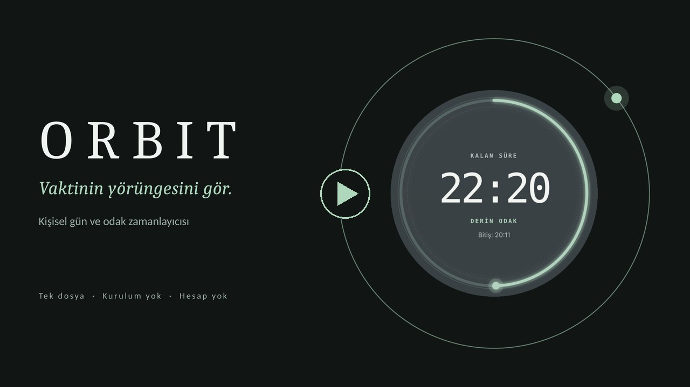

# ORBIT

▶ Tanıtım videosunu izlemek için görsele tıkla (1:52)

**Kişisel gün ve odak zamanlayıcısı.** Tek bir HTML dosyası; kurulum yok, hesap yok, internet bağlantısı gerekmiyor.

ORBIT, gün içinde neye ne kadar zaman verdiğini sade bir şekilde takip etmek için tasarlandı. Bir görev seçersin, sayaç başlar; seans bitince süre kaydedilir ve günün, haftanın, ayın nasıl geçtiğini analiz ekranında görürsün.

---

## Özellikler

**Seanslar**
- **Planlı mod:** 25, 45, 60 ya da 90 dakikadan geriye sayar.
- **Serbest akış:** Sınır olmadan, sen bitirene kadar süre tutar.
- **Mola:** 5 ya da 15 dakika; mola süresi çalışma raporuna eklenmez.
- Seans sürerken sekme başlığında kalan süre görünür; pencere arka plandayken de gerçek zamanı esas alır.

**Görevler**
- Kendi görevlerini oluştur, ikonunu seç, açıklama ekle.
- Görevleri sürükleyerek (ya da klavyeyle) sırala.
- **Kişisel** grup: dinlenme ya da keyif için ayırdığın zaman ayrı tutulur, odak süresine sayılmaz.
- Günlük ilerleme çubuğu ve tamamlanan görev sayısı.

**Zaman analizi**
- Günlük, haftalık ve aylık raporlar.
- Görev dağılımı (halka grafik), ayrıntılı döküm ve günlük saat şeridi: hangi saatte neyle uğraştığını gösterir.
- Raporu CSV olarak dışa aktarma.

**Temalar**
Her temanın kendine özgü, kısa ve sessiz bir dokunuşu var:
- **Graphite:** Sayaç halkasının ucunda yörüngede dönen küçük bir uydu.
- **Editorial:** Tamamlanan görevin üzerinden geçen kalem çizgisi ve "tamam" damgası.
- **Retro Terminal:** Yanıp sönen imleç, harf harf yazılan başlıklar.
- **Cinema:** Seans başında film şeridi gibi 3-2-1 geri sayımı, sonunda "SON" kartı.
- Bütün temalarda molada gerinen küçük bir kedi. 🐈

Bilgisayarında "hareketi azalt" ayarı açıksa efektler kendiliğinden kapanır.

---

## Kullanım

1. `index.html` dosyasını indir.
2. Tarayıcında aç (Chrome, Firefox, Safari, Edge).
3. Hepsi bu.

**Kısayollar**
- `Boşluk`: seansı duraklat / devam ettir
- `Esc`: açık pencereyi kapat
- Görev tutamacındayken `↑` `↓`: görevin sırasını değiştir

---

## Verilerin nerede?

Bütün kayıtların **yalnızca kendi tarayıcında** durur. Hiçbir sunucuya gönderilmez, kimse göremez.

Bunun bir bedeli var: tarayıcı verilerini silersen ya da başka bir bilgisayara geçersen kayıtların gelmez. O yüzden ara sıra **"Verileri yedekle"** butonuyla bir JSON yedeği indir; ORBIT bir hafta yedek almadığında sana hatırlatır. Yedeği **"Yedekten yükle"** ile geri alabilirsin.

---

## Yapım

Fikir ve tasarım: [Lryiu](https://lryiu.com)
